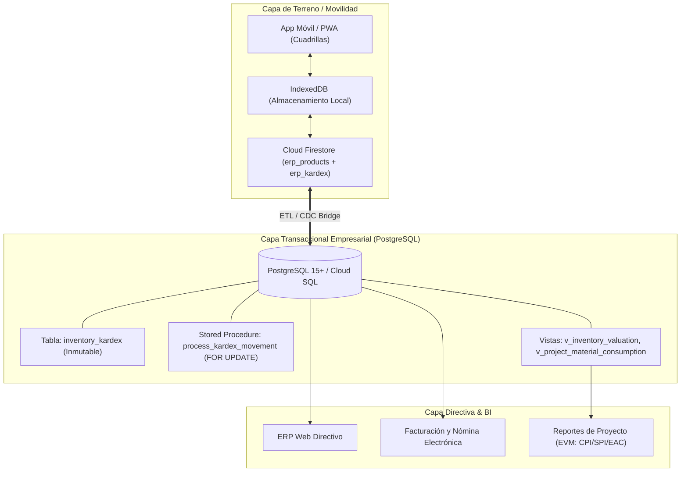

# Arquitectura de Persistencia Empresarial: PostgreSQL + Edge Cloud (Inteckno ERP)

Este directorio contiene los artefactos de migración y arquitectura relacional para la evolución de **Inteckno ERP** hacia **PostgreSQL** (Google Cloud SQL, Supabase o Neon).

---

## 1. Arquitectura Híbrida Recomendada: The Dual-Stack Engine

Para garantizar tanto la **velocidad y trabajo offline en campo** (pilonas de teleféricos sin cobertura de internet) como la **máxima rigurosidad contable y control de stock** (Kardex ACID inmutable), Inteckno implementa una arquitectura híbrida:



---

## 2. Ventajas Clave del Esquema PostgreSQL

1. **Bloqueo Pesimista (`SELECT FOR UPDATE`):**
   - El procedimiento almacenado `process_kardex_movement` bloquea exclusivamente la fila del producto solicitado.
   - Si dos almacenistas intentan retirar la última unidad al mismo microsegundo, la segunda transacción espera y el sistema rechaza automáticamente la salida con la excepción: `Stock insuficiente para SKU X`.
2. **Kardex Inmutable con Costo Promedio Ponderado:**
   - Cada entrada de compra recalcula el costo unitario promedio en COP según la fórmula contable estándar.
   - Cada salida descuenta stock y registra el costo histórico incurrido imputado al proyecto.
3. **Costo Fijo y Escalabilidad:**
   - Frente a Firestore (que cobra por cada lectura y escritura individual de documento), PostgreSQL tiene un costo fijo predecible mensual independientemente de si se realizan 1.000 o 1.000.000 de consultas al catálogo.

---

## 3. Instrucciones de Despliegue

### Opción A: Despliegue en Google Cloud SQL (PostgreSQL)
1. En Google Cloud Console, crea una instancia de Cloud SQL:
   ```bash
   gcloud sql instances create inteckno-db-prod \
       --database-version=POSTGRES_15 \
       --tier=db-custom-2-7680 \
       --region=us-central1 \
       --storage-auto-increase
   ```
2. Conéctate a la instancia y ejecuta el script:
   ```bash
   gcloud sql connect inteckno-db-prod --user=postgres < database/schema_postgresql.sql
   ```

### Opción B: Despliegue en Supabase (Recomendado para inicio rápido)
1. Crea un proyecto en [supabase.com](https://supabase.com).
2. Abre el **SQL Editor** en la consola del proyecto.
3. Copia y pega el contenido completo de `database/schema_postgresql.sql`.
4. Haz clic en **Run**. El esquema, extensiones, tablas, procedimiento de bloqueo y vistas quedarán activos de inmediato.
